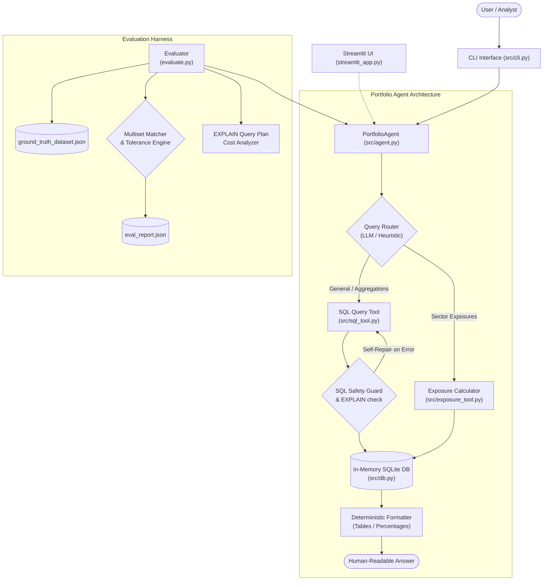

# Portfolio Analytics Agent

An intelligent, multi-tool AI assistant for portfolio analytics built with Python, in-memory SQLite, and Google Gemini (`gemini-2.5-flash` via the `google-genai` SDK). The agent converts natural-language questions into safe SQL queries, executes deterministic sector exposure calculations, and validates answers against ground-truth benchmarks.

---

## Architecture Overview



---

## Key Features

1. **In-Memory Relational Database (`src/db.py`)**:
   - Reconstructs 9 financial tables (`portfolios`, `holdings`, `securities`, `sectors`, `transactions`, `benchmarks`, `historical_prices`, `portfolio_performance`, `risk_metrics`) in SQLite with strict foreign key constraints (`PRAGMA foreign_keys = ON`).
   - Cleanly handles real-world data quirks: converts bond empty sector fields and quoted prices to proper `NULL` and numeric types.
   - Extracts schema descriptions and distinct-value hints for the LLM.

2. **Text-to-SQL Tool with Multi-Layered Safety (`src/sql_tool.py`)**:
   - Employs `gemini-2.5-flash` with domain rules (e.g. portfolio value = `SUM(quantity * current_price)`, handling `NULL` sector IDs for bonds).
   - **Safety layers**:
     - Enforces `PRAGMA query_only = ON` on connection execution.
     - Blocks mutation statements (`INSERT`, `UPDATE`, `DELETE`, `DROP`, `ALTER`, `ATTACH`, `PRAGMA`, etc.) via word-boundary regex.
     - Enforces single-statement execution (blocks command chaining via `;`).
     - Pre-validates syntax using `EXPLAIN` before running.
     - One-shot **LLM self-repair**: automatically feeds syntax errors back to the model for correction.
     - Enforces a 1,000-row result limit safeguard.

3. **Deterministic Exposure Calculator (`src/exposure_tool.py`)**:
   - Pure Python/pandas mathematics — eliminates LLM hallucination for portfolio weights.
   - Forgiving portfolio name resolution (exact match, token matching, fuzzy substring matching via `difflib`).
   - Strictly ignores bonds (`asset_type == 'Stock'`) as per domain requirements.
   - Computes both **renormalized equity exposure** (summing to 100%) and **raw portfolio exposure**.
   - Handles edge cases: detects 100% bond portfolios (Portfolios 8 and 12) and returns informative messages instead of division-by-zero errors.

4. **Robust Agent & CLI (`src/agent.py`, `src/cli.py`)**:
   - Intelligent tool routing with automatic heuristic fallback if an API key is omitted.
   - In-memory MD5 question caching.
   - Clean, fixed-width ASCII table output.
   - Fully Windows-compatible (`python -m src.cli`).

5. **Evaluation Harness & Performance Cost Proxy (`evaluate.py`)**:
   - Multi-metric evaluation comparing query execution results (multiset equivalence, float normalization to 2 decimal places, ordered checks when `ORDER BY` is present).
   - Independent recalculation of exposure metrics within 0.01 tolerance.
   - **Performance Cost Proxy**: inspects `EXPLAIN QUERY PLAN` output for every query to detect and flag full table scans versus indexed lookups.
   - `--offline` mode to verify functionality without an API key.

---

## Project Structure

```
Exercise_PL_AI_Engineer/
├── data/                      # 9 financial CSV tables
│   ├── benchmarks.csv
│   ├── historical_prices.csv
│   ├── holdings.csv
│   ├── portfolio_performance.csv
│   ├── portfolios.csv
│   ├── risk_metrics.csv
│   ├── sectors.csv
│   ├── securities.csv
│   └── transactions.csv
├── src/
│   ├── __init__.py
│   ├── agent.py               # PortfolioAgent & router
│   ├── cli.py                 # Interactive & one-shot CLI
│   ├── db.py                  # In-memory SQLite loader & schema descriptor
│   ├── exposure_tool.py       # Deterministic sector exposure calculator
│   ├── llm.py                 # Gemini wrapper with retries & backoff
│   └── sql_tool.py            # Text-to-SQL tool & safety validator
├── tests/
│   ├── __init__.py
│   ├── test_db.py             # Database loader and foreign key tests
│   ├── test_exposure.py       # Sector exposure calculation & edge case tests
│   └── test_sql_validator.py  # SQL injection & safety validation tests
├── database_schema.sql        # SQLite schema definition
├── ground_truth_dataset.json  # 10 evaluation test questions
├── evaluate.py                # Evaluation harness & cost analyzer
├── streamlit_app.py           # Optional interactive Web UI
├── ASSIGNMENT.md              # Original assignment brief
├── requirements.txt           # Project dependencies
├── .env.example               # Environment template
└── .gitignore                 # Git ignore rules
```

---

## Setup Instructions

### 1. Prerequisites
- Python 3.10+ (tested on Python 3.12)
- Windows, macOS, or Linux

### 2. Environment Setup

```powershell
# Create and activate virtual environment
python -m venv .venv

# On Windows (PowerShell):
.venv\Scripts\Activate.ps1

# On macOS/Linux:
source .venv/bin/activate

# Install dependencies
pip install -r requirements.txt
```

### 3. Configure API Key

Copy `.env.example` to `.env` and add your Gemini API key from [Google AI Studio](https://aistudio.google.com/):

```powershell
Copy-Item .env.example .env
```

Edit `.env`:
```ini
GEMINI_API_KEY=AIzaSy...your_key_here
```

*(Note: You can still run the entire test suite and offline evaluator without an API key).*

---

## How to Run

### 1. Interactive CLI
Launch the interactive command-line session:

```powershell
python -m src.cli
```

Example session:
```text
============================================================
  Portfolio Analytics Agent
  Type your question, or 'exit' to quit.
============================================================

> What are the sector exposures for the Tech Innovation Fund?

  Tool: exposure_calculator
  Portfolio: Tech Innovation Fund
  Time: 3ms

Sector Exposure for: Tech Innovation Fund
(Equity weight: 100.0% of portfolio | Bonds excluded: 0)

Sector                        % of Equity  % of Portfolio
----------------------------------------------------------
Technology                        100.00%         100.00%
```

### 2. One-Shot CLI Query
Execute a single question from the terminal and exit:

```powershell
python -m src.cli "Calculate the sector exposure breakdown for international equity"
```

### 3. Run the Evaluation Suite

**Offline Mode (No API key needed — validates harness & logic):**
```powershell
python evaluate.py --offline
```

**Live Evaluation (Using Gemini API):**
```powershell
python evaluate.py
```

**Verbose Mode (Show generated SQL, query plans, and detailed timings):**
```powershell
python evaluate.py --offline --verbose
```

**Evaluate Specific Questions:**
```powershell
python evaluate.py --offline --ids 1,3,9,10
```

### 4. Run Automated Unit Tests

```powershell
python -m pytest tests/ -v
```

### 5. Launch the Streamlit Web UI (Bonus)

```powershell
streamlit run streamlit_app.py
```

### 6. Run the FastAPI REST Server (Bonus)

```powershell
uvicorn src.api:app --reload --port 8000
```

Interactive OpenAPI documentation is available at `http://127.0.0.1:8000/docs`.

---

## Design Decisions & Technical Highlights

1. **Result-Based Evaluation Over SQL String Matching**:
   SQL has multiple valid syntactic representations for the same intent (e.g. subqueries vs. CTEs, different join orders, table aliases). Evaluating by executing queries and comparing row multisets (normalized to 2 decimal places) avoids penalizing valid SQL variations while strictly validating correctness.

2. **Deterministic Exposure Calculation vs. LLM Prompts**:
   Portfolio weights and sector allocations require 100% mathematical precision. Performing the calculation in Python/pandas guarantees exact figures without token rounding errors or hallucinations, reserving the LLM for semantic classification.

3. **Dual Exposure Views & Handling Mixed Portfolios**:
   - `exposure_pct_of_equity`: Renormalizes equity holding weights so they sum to 100%. Essential for mixed portfolios like Portfolio 2 (equity weight 0.32) and Portfolio 4 (equity weight 0.36).
   - `exposure_pct_of_portfolio`: Raw sum of weights as a percentage of the entire portfolio, clearly reflecting cash/bond remainder.
   - For all-bond portfolios (Portfolios 8 and 12), the calculator explicitly returns an informative message ("no equity holdings, exposure is undefined") rather than encountering a `ZeroDivisionError`.

4. **Multi-Tiered SQL Safety Guard**:
   - Pre-execution keyword and statement regex blocking.
   - Read-only connection enforcement (`PRAGMA query_only = ON`).
   - Syntax dry-run using SQLite `EXPLAIN`.
   - Automated self-repair retry loop that returns execution errors to the LLM for query correction.

5. **Performance Cost Proxy (`EXPLAIN QUERY PLAN`)**:
   `evaluate.py` parses SQLite query plans. It automatically distinguishes between index searches (e.g. `SEARCH TABLE securities USING INDEX idx_securities_sector`) and full table scans (`SCAN TABLE portfolios`), alerting the analyst to optimization opportunities.

---

## Actual Evaluation Output

### Live Evaluation (with Gemini API)
```text
================================================================================
  Portfolio Analytics Agent – Evaluation (LIVE)
================================================================================

Q1 [easy] (text2sql): How many portfolios do we have in total?
  ✓ PASS | tool=sql_query | 4026ms
    [Perf Optimal] Index lookups: 1 index scan(s)

Q2 [easy] (text2sql): What are the names of all active portfolios?
  ✓ PASS | tool=sql_query | 2455ms
    [Perf Alert] Full table scan detected: SCAN portfolios

Q3 [easy] (text2sql): Which securities are in the Technology sector?
  ✓ PASS | tool=sql_query | 3360ms
    [Perf Optimal] Index lookups: 2 index scan(s)

Q4 [medium] (text2sql): What is the total Assets Under Management (AUM) for portfolios with high target risk level?
  ✓ PASS | tool=sql_query | 4053ms
    [Perf Alert] Full table scan detected: SCAN portfolios

Q5 [medium] (text2sql): Show me the top 5 holdings by cost basis in the Growth Equity Fund
  ✓ PASS | tool=sql_query | 4120ms
    [Perf Optimal] Index lookups: 2 index scan(s)

Q6 [medium] (text2sql): What is the average current price of securities in each sector?
  ✓ PASS | tool=sql_query | 13323ms
    [Perf Optimal] Index lookups: 2 index scan(s)

Q7 [hard] (text2sql): For each portfolio, show the total value of Technology sector holdings and what percentage it represents of the total portfolio value
  ✓ PASS | tool=sql_query | 14753ms
    [Perf Alert] Full table scan detected: SCAN th

Q8 [hard] (text2sql): Find portfolios that have holdings in more than 5 different sectors and show their diversification metrics
  ✓ PASS | tool=sql_query | 17272ms
    [Perf Optimal] Index lookups: 1 index scan(s)

Q9 [medium] (exposure_calculator): What are the sector exposures for the Tech Innovation Fund?
  ✓ PASS | tool=exposure_calculator | 0ms

Q10 [medium] (exposure_calculator): Calculate the sector exposure breakdown for international equity
  ✓ PASS | tool=exposure_calculator | 0ms

================================================================================
  SUMMARY
================================================================================
  Overall: 10/10 (100% PASS)
  text2sql: 8/8 (100% PASS)
  exposure_calculator: 2/2 (100% PASS)
================================================================================
```

---

## Known Limitations & Future Roadmap

- **Hybrid Questions**: Queries that require both tools simultaneously (e.g., "Find the active high-risk portfolio with the highest AUM and show its sector exposures") currently route to a single tool. A planner-executor pattern could decompose these into sequential tool steps.
- **Dynamic Database Updates**: The database is presently held in memory from static CSV files. Supporting live persistence with SQLite WAL mode on disk or PostgreSQL would enable real-time transaction ingestion.
